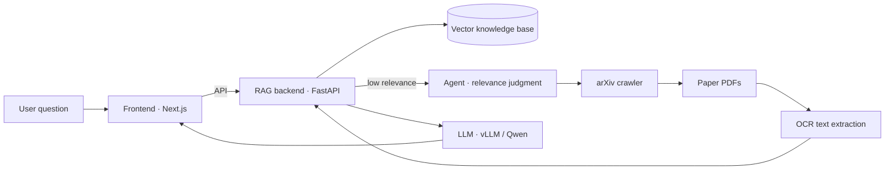
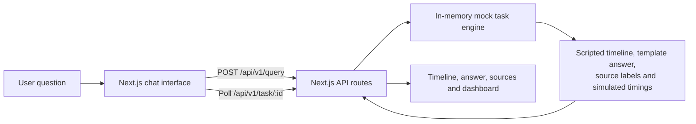
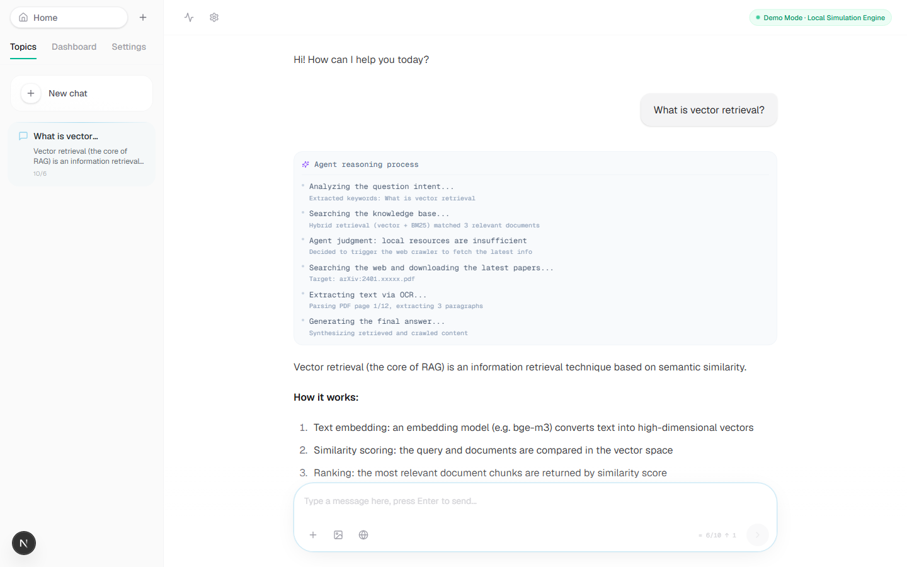
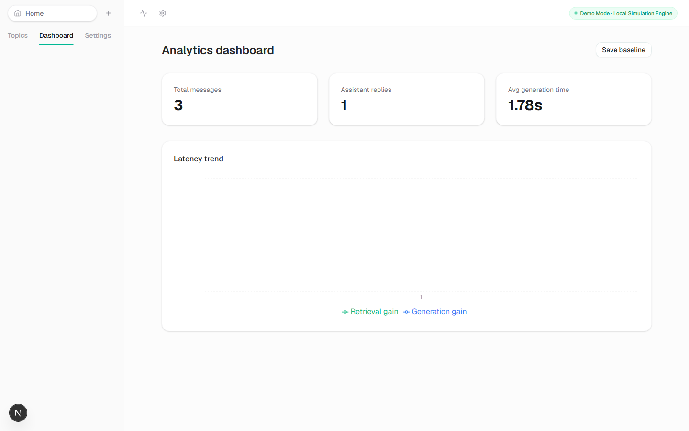

# Multimodal Academic Literature Retrieval System

**Completed Provincial-level Undergraduate Innovation Research Project | Frontend Demonstration**

A faculty-supervised undergraduate research project at **South China Agricultural University, China**. The overall research project has officially concluded. This repository primarily showcases a **mock-driven frontend demonstration**, alongside additional research-related backend code. It does not establish that the complete integrated RAG system has been reproduced or deployed successfully.

## Project Overview

Academic literature combines prose, figures, tables, and other document elements, making relevant information difficult to locate and its supporting evidence difficult to inspect. The broader team project explored how information retrieval, Retrieval-Augmented Generation (RAG), and agent-based workflows could support academic literature search and evidence-based question answering. The research concept combined local knowledge retrieval with relevance assessment and, when needed, acquisition and processing of additional papers. A central interface objective was to make retrieval stages, document sources, and answer presentation easier for users to follow. This repository demonstrates that interaction design through a simulated workflow. It provides an inspectable frontend prototype for retrieval transparency and evidence presentation; its mock outputs are not evidence of multimodal understanding, retrieval effectiveness, or autonomous agent performance.

## My Contributions

My responsibilities within the faculty-supervised team project primarily involved **frontend development, retrieval process visualisation, evidence presentation, and user interaction design**. The frontend implementation includes:

- An interactive academic question-answering interface with question submission, conversation navigation, and loading states.
- A processing timeline that visualises query analysis, retrieval, relevance judgment, web search, OCR, and response generation using simulated events.
- Structured Markdown answer rendering and presentation of source labels and response metadata.
- User interaction and response display, including file/image selection and attachment previews. The main submission path sends the question text; attachment processing is not integrated into that path.
- Retrieval/generation latency indicators and an analytics dashboard with message counts, latency trends, and baseline comparisons. Demo latency values are simulated.

These contributions concern the frontend and its presentation of research workflows. Backend retrieval algorithms, LLM training, OCR model development, and crawler implementation are broader team/codebase components and are not claimed here as my individual work. See the [chat and dashboard component](frontend/components/multimodal-chat.tsx) and [mock task engine](frontend/lib/store.ts).

## Implemented Features and Demo Limitations

| Capability | Status in this repository |
|---|---|
| Chat interface and question submission | Implemented; questions create tasks and the frontend polls for progress. |
| Agent workflow visualisation | Implemented UI; query analysis, hybrid retrieval, judgment, web search, OCR, and generation stages are scripted. |
| Structured answers and source display | Implemented Markdown rendering and source-label display; demo answers and labels are predefined. |
| Statistics and analytics dashboard | Implemented indicators, counts, and charts; retrieval/generation timings are simulated, not measured backend performance. Token-related UI is not a validated inference-usage report. |
| File/image input | Selection and previews exist; real multimodal ingestion is not established by the demo. |
| Vector search and BM25 | Related FAISS, embedding, and BM25 code exists in `rag/`; the standalone demo does not execute it. |
| Autonomous agent decision-making | Related prototypes exist in `query-relevance/`; the demo timeline is not an autonomous reasoning trace. Some prototype tools also return mock content. |
| arXiv crawling and OCR | Crawler, PDF extraction, and OCR-related code exists; these stages are simulated in the demo. |
| Live LLM inference | Model connection/loading code exists; the demo uses template answers without model inference. |
| End-to-end backend integration | API adapters exist, but full integrated operation has not been verified within this repository. |

**Mock-generated answers, source labels, confidence values, and latency indicators are demonstration data, not validated experimental results.** Labels such as `arXiv:2401.xxxxx.pdf` are placeholders. Demo text discussing self-improvement or fine-tuning does not establish an implemented learning or training loop.

## System Architecture

### Research System Architecture (Conceptual / Team Project)

The original research architecture is retained below as a conceptual view of the broader team system. Its arrows describe intended relationships, not a verified production deployment. The low-relevance path summarises a fallback workflow; backend code also contains controller-based relevance checks.



### Standalone Frontend Demonstration

This is the default demonstration path. Next.js serves both the interface and local mock API routes; no separate Python backend is needed.



## Technology Stack

| Scope | Technologies and role |
|---|---|
| Demonstrated frontend | Next.js 16, React 19, TypeScript, Tailwind CSS 4, shadcn/ui with Radix UI, Recharts, React Markdown, Axios. |
| Standalone demo services | Next.js API routes and a TypeScript in-memory mock task store. |
| Additional retrieval/QA source | Python, FastAPI, LangChain, Hugging Face Transformers, PyTorch, FAISS, BM25, and code for a vLLM-compatible model service. |
| Additional document/acquisition source | requests, BeautifulSoup, LangChain's ArxivRetriever, PyMuPDF (`fitz`), and optional PaddleOCR imports. |
| Additional query/agent source | LangChain agent and query-processing prototypes with Qwen/DashScope-related configuration. |

The backend requirements files list only part of the packages referenced by the research source. Their presence does not establish a complete reproducible environment or integration with the demo.

## Quick Start

Install Node.js and npm, then run from the repository root:

```bash
cd frontend
npm install
npm run dev
```

Open **http://localhost:3000**. If that port is occupied, use the address printed by Next.js.

On a fresh checkout with no `BACKEND_URL` configured, the main question/task routes automatically use the mock engine. To explicitly select this path, create `frontend/.env.local` containing:

```dotenv
DEMO_MODE=true
```

Leave `BACKEND_URL` unset for a standalone demonstration. Restart the development server after changing environment variables. The demo requires **no API keys, GPU, model downloads, or separate backend services**. Installing npm packages requires network access; the current layout also references Google fonts through Next.js.

Enter **"What is vector retrieval?"** and wait for the simulated timeline and answer to complete. Select **Dashboard** to inspect the demonstration statistics. The workflow uses task polling rather than a live LLM token stream.

## Demo Screenshots

The existing screenshots are preserved and illustrate the mock interface.



*Chat demonstration: "What is vector retrieval?" with query analysis, simulated hybrid retrieval, relevance judgment, web search, OCR, and a structured answer. The workflow is scripted. Source labels and latency indicators are implemented below the answer but are outside this screenshot's visible area; this image does not document those elements.*



*Dashboard demonstration: message counts and a simulated generation-time indicator. The saved image contains only one response and no meaningful multi-point latency trend; it is not an experimental comparison or performance benchmark.*

## Project Status and Limitations

- The provincial-level undergraduate innovation research project has officially concluded.
- This repository is a demonstrative frontend implementation with additional research-related source code. The default demo uses simulated retrieval and agent responses.
- Full end-to-end integration has not been verified within this repository. Backend configuration, model availability, dependencies, and retrieval behaviour require independent validation.
- The demo does not establish real-world retrieval accuracy, model performance, reliable source attribution, or autonomous agent effectiveness. Its source labels are not verified evidence citations.
- The mock task store is in memory and is not a persistent research dataset or production task service.

## Future Research Directions

Potential extensions include evaluating real hybrid retrieval on a documented academic corpus; comparing BM25, dense retrieval, and their combination using relevance judgments and metrics such as **Recall@K** and **nDCG@K**; improving source attribution with passage-level evidence and document locations; and integrating and evaluating LLM-based agents for retrieval and evidence selection. These are prospective research directions, not completed results reported by this demonstration.

## License

Distributed under the [MIT License](LICENSE). The existing license and copyright notice are unchanged.
